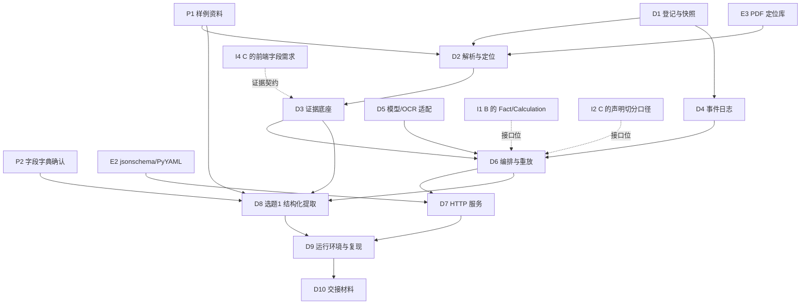

# 成员 A 任务实施计划书

| 项目 | 内容 |
|---|---|
| 版本 | v1.0（计划） |
| 对应契约版本 | `api_version=1.0.0`（`contracts/contracts.schema.json`、`contracts/openapi.yaml`） |
| 依据文档 | `AGENTS.md`、`docs/项目总纲.md`、`docs/接口约定.md`、`docs/给成员和AI助手的任务说明.md`、`实施路线与验收清单.md` |
| 负责范围 | `api/`、`app/ingest/`、`app/parse/`、`app/evidence/`、`app/orchestrator/`、`app/models/`、`app/logging/` + 选题 1 `structured_extraction` |
| 计划状态说明 | 本文既是**后续工作的计划**，也是**当前基线的盘点**。已落地的部分标 ✅ 并注明"待验证"，未落地的标 ⬜ |
| 职责口径 | A 的主干是**解析、编排、接口、运行复现**四条线。注意区分两个容易混用的词：**文档解析（`app/parse/`，A 负责）** 与 **财务事实归一化（`app/facts/`，B 负责）**；A 不实现财务口径与计算，只提供 `Fact`/`Calculation` 的存储、校验与编排接入位 |

---

## 1. 一句话目标

在固定资料包内，把"公告/财报/研报等原始文件"变成**每个数值都能返回原文页码与坐标、每次调用都留痕、同一输入可离线重放**的结构化结果，并通过同一套 `/api/v1` 接口对外提供七题的运行能力（七题中 A 自己交付选题 1，其余六题提供编排与接口位）。

**A 的成功标准不是"跑出数字"，而是三条可被评审当场验证的性质：**

1. **可溯源**：任一输出字段能回跳原文页码 + 归一化框选坐标（0—1000，左上角原点）。
2. **不编造**：找不到/读不清的字段一律 `value=null` + `status=needs_review` + `reason`，绝不填 0 或臆测值。
3. **可复现**：固定输入 + 固定代码版本 → 同一 `input_hash` / `result_hash` / 工具调用轨迹；事件流有哈希链可校验未被改写。

---

## 2. 范围内 / 范围外

### 2.1 范围内（A 交付）

| 编号 | 交付物 | 主要落地位置 |
|---|---|---|
| D1 | 文件登记与内容快照：SHA-256、稳定 ID、版本关联、格式/大小/页数限制 | `app/ingest/`、`app/storage/` |
| D2 | 解析与定位：PDF 文本层（逐字符 bbox）、TXT/CSV/XLSX、表格行列、扫描件与 OCR 判定 | `app/parse/` |
| D3 | 证据底座：Evidence 生成、索引、按 ID 查询、页码坐标可框选 | `app/parse/index.py`、`app/parse/service.py` |
| D4 | 事件日志：状态/文件访问/工具调用/模型调用/计算/导出/错误七类事件、哈希链、运行清单目录 | `app/logging/` |
| D5 | 模型适配层：`ModelPort` 实现、离线确定性后端、模型/提示词版本记录、OCR 适配器 | `app/models/` |
| D6 | 编排与重放：Run 状态机、TaskResult 组装、失败恢复、离线重放比对、人工复核回写 | `app/orchestrator/` |
| D7 | HTTP 服务：OpenAPI 的端点、统一错误结构、`X-Request-Id` | `api/` |
| D8 | 选题 1 `structured_extraction`：三类公告字段抽取（字段字典 v1） | `app/tasks/structured_extraction/` |
| D9 | 运行环境与一键复现：CLI、依赖声明、运行说明、样例包、自检脚本 | `app/cli.py`、`pyproject.toml`、`README.md`、`samples/`、`tools/` |
| D10 | 交接材料：运行说明、成功样例、失败样例、契约校验结果、来源定位输出、未解决问题 | `docs/`、`var/runs/` 运行清单 |

### 2.2 明确不做（属 B / C，A 只提供接口位与联调桩）

| 事项 | 主责 | A 的边界 |
|---|---|---|
| 指标字典、期间/合并口径、同比与单季运算、异常信号、估值假设（`app/facts/`、`app/tools/`） | B | A 只提供 `Fact`/`Calculation` 的存储与校验位，不实现财务口径 |
| `financial_analysis`、`industry_impact`、`valuation`、`investment_memo` | B | A 保证 `POST /runs` 能接住这四题并正确落状态，插件由 B 提供 |
| `research_verification`、`report_quality`、`eval/`、`web/`、视频 | C | A 提供证据定位接口与结果读取接口供前端调用 |
| 人工标注与留出集评测数字 | C（B 复核金融规则） | A 只提供可复跑的脚本与运行记录，不产出评测结论 |
| 任何公共字段的改动 | 三人评审 | A 不私自改契约；发现歧义写入 `docs/接口问题记录.md` |

---

## 3. 前置条件（必须先满足，否则对应工作无法验收）

### 3.1 输入侧前置条件

| 编号 | 前置条件 | 提供方 | 阻塞的交付物 | 缺失时的降级方案 |
|---|---|---|---|---|
| P1 | 样例资料包：同一公司 1 份年报、1 份半年报、≥2 类公告、1 份含注入错误的研报草稿 | A 收集 + C 标注 | D2、D3、D8 | 已用自编示例样例（`samples/`）联调；**页面与视频必须标注"接口演示样例"** |
| P2 | 公告字段字典确认（质押/中标/股权变动三类的字段代码与中英文表头写法） | A 起草 → B/C 确认 | D8 | 按 `docs/接口约定.md` 字段字典 v1 冻结；新增字段先登记 |
| P3 | 公告类型的判定规则（标题关键词、标题行位置） | A | D8 | 现有从严规则（标题行/文件前两行/分节标题）已在样例上验证 |
| P4 | 资料使用授权与来源记录（下载页、披露日、下载日、哈希） | 三人 | D9 | 只用已公开材料；缺来源的材料不进固定包 |
| P5 | 扫描件是否纳入评测集 | 三人 | D2 | 当前环境无 OCR 引擎，扫描页只能返回 `DOCUMENT_PARSE_FAILED` + 人工录入提示 |

### 3.2 环境侧前置条件

| 编号 | 前置条件 | 现状 | 影响与应对 |
|---|---|---|---|
| E1 | Python ≥ 3.10 | 3.11.4 可用 | — |
| E2 | `jsonschema`、`PyYAML`（契约校验必需） | 已装 | 写入 `pyproject.toml` 依赖 |
| E3 | PDF 文本层定位库 | `pypdf`、`pdfminer.six` **未装在系统 Python**，已装入 `vendor/python` | `app/bootstrap.py` 自动加入 `sys.path`；缺失时退回纯标准库后端（只支持 FlateDecode + WinAnsi/ToUnicode），功能降级但不报错 |
| E4 | 表格读取 | `openpyxl` 可用；另有内置 XLSX 解析器 | 双路径，任一可用即可 |
| E5 | OCR 引擎 | **无**（未检测到 tesseract/pytesseract） | `OcrAdapter` 显式报告不可用；扫描件走失败/待复核，不假装解析成功 |
| E6 | 中文字体 | 宿主机有 `simhei.ttf` 等 | 生成带中文文本层的 PDF 样例需要；缺失时脚本跳过并返回 0，不阻塞 |
| E7 | 数据目录可写 | `var/`（运行数据）+ `vendor/`（可选依赖） | 已加入 `.gitignore`；`FINSCOPE_DATA_DIR` 可切换 |

### 3.3 依赖其他成员的接口点（A 需要别人"先给出形状"，不需要别人先写完）

| 编号 | A 依赖的东西 | 依赖谁 | 现在能不能做 | 解耦办法 |
|---|---|---|---|---|
| I1 | `Fact`、`Calculation` 的结构与 `extract_facts(document_ids, field_codes)` 语义 | B | 能（契约已冻结） | A 不实现事实抽取，只在编排层保留 `Context` 入口；B 的模块未到位时，`financial_analysis` 返回 `MISSING_INPUT` 并注明主责 |
| I2 | 研报草稿中"声明"的切分口径与错误类型枚举 | C（B 复核金融规则） | 部分（枚举已在 Schema 冻结） | A 只保证 `research_verification` 的 `task_input`、`TaskResult` 形状可跑通 |
| I3 | `report_quality` 评分维度与权重 | C | 形状可做 | 契约要求权重合计 100，A 在契约校验里保留该断言 |
| I4 | 前端需要的证据定位字段（页码、bbox、章节） | C | 能 | D3 已按契约输出；额外需要（如表格合并单元格）先记入接口问题记录 |
| I5 | 三类公告的真实样例（含跨页表格、扫描页、单位混用、多主体） | 三人 | 否 | 先用自编样例打通，真实样例到位后回归 |

**关键结论：A 的任务里真正被"别人没写完"阻塞的只有两处** ——
① 七题中的六题插件（B/C）只能验证接口形状，不能验证业务正确性；
② 真实公告/研报样例（P1、I5）未到位前，选题 1 与选题 5 只能算"接口演示样例"。
其余（登记、解析、证据、日志、编排、API、重放、选题 1）**不依赖任何人的代码**，可以立即完成并验收。

---

## 4. 依赖图与关键路径

**关键路径：** `D1 → D2 → D3 → D8 → D9`（证据底座 + 选题 1 是演示主线的单点依赖）。
**并行分支：** `D4`（日志）、`D5`（模型适配）、`D7`（HTTP）可在 D3 完成前先按契约并行开发。

---

## 5. 分交付物清单

> 状态图例：✅ 已完成且已自测 · 🟡 已完成待验证/待补测试 · ⬜ 未开始
> "验证命令"列一律可在项目根目录直接执行。

### D1 文件登记与内容快照 — ✅（待补 1 条测试）

| 项 | 内容 |
|---|---|
| 输入 | `file` 字节流、可选 `source_url`、`disclosure_date` |
| 输出 | 契约 `Document` |
| 关键设计 | 文档身份 = `(sha256, source_url, disclosure_date)`；内容寻址快照 `var/blobs/<前两位>/<sha256>`，已存在不覆盖 |
| 前置 | P4（来源与授权）、E7 |
| 验收要点 | 同一文件重复登记 → 同一 `document_id`；同内容不同披露日 → 新文档但共享快照；非白名单扩展名 → `DOCUMENT_UNSUPPORTED`(415)；超限 → `FILE_TOO_LARGE`(413) |
| 验证命令 | `python -m pytest tests/test_ingest_parse.py -k "twice or corrected or unsupported or oversized"` |
| 未完成项 | ⬜ 补充"页数超限"用例（构造 >`FINSCOPE_MAX_PDF_PAGES` 的 PDF） |

### D2 解析与定位 — ✅（PDF/TXT/CSV/XLSX 四路已跑通）

| 项 | 内容 |
|---|---|
| 输入 | 已登记的 `document_id` |
| 输出 | `ParseManifest`（`evidence_ids`、`warnings`、`page_count`、`status`） |
| 关键设计 | PDF 三级后端：`pdfminer.six`（逐字符 bbox，首选）→ `pypdf`（仅文本，坐标不可得则标待复核）→ 纯标准库内容流解释器（FlateDecode + WinAnsi/ToUnicode + Identity-H）；字符按 y 分组成行并回填字符区间，使"正则命中位置 → 页码 + bbox"可稳定映射 |
| 前置 | E3、E6、P5 |
| 验收要点 | 抽查"本次质押股数"行：页面 595×842、基线 y=690、字号 11 → 归一化 y ≈ 169—184；无文本层 → `DOCUMENT_PARSE_FAILED`(422) 且提示需要 OCR |
| 验证命令 | `python -m pytest tests/test_ingest_parse.py -k "parse"`；`python tools/smoke_extraction.py` |
| 已知限制 | TXT/CSV/XLSX 无原生坐标，bbox 为**按行/行列推导的近似版面**（`confidence` 0.7/0.95）并在 `warnings` 显式声明，不得当作原件框选位置；不解析 PDF Form XObject 内嵌套文本；不做表格单元格合并还原 |
| 未完成项 | ⬜ 真实年报（跨页表格、旋转页）回归；⬜ 页级 `rotate` 非 0 时的坐标校正验证 |

### D3 证据底座 — ✅

| 项 | 内容 |
|---|---|
| 输入 | 解析索引 + 字段命中区间 |
| 输出 | 契约 `Evidence`（`page`、`bbox`、`text` 短片段、`extraction_method`、`confidence`、表格题带 `table_id/row/column`） |
| 关键设计 | `evidence_id` 由 `(document_id, page, bbox, text, method, row, column)` 内容派生 → 重放稳定；`text` 只存短片段（带上下文窗口），完整文件走 `GET /documents/{id}/content` |
| 验收要点 | 每条证据 `0 ≤ x0 < x1 ≤ 1000`、`0 ≤ y0 < y1 ≤ 1000`、`page ≥ 1`；表格证据 `row/column` 从 1 开始 |
| 验证命令 | `python -m pytest tests/test_ingest_parse.py -k "evidence or bbox or row_column"` |
| 未完成项 | ⬜ 前端框选联调（依赖 I4）；⬜ 证据片段长度策略写入 README |

### D4 事件日志与运行清单 — ✅

| 项 | 内容 |
|---|---|
| 输出 | 契约 `Event` / `EventPage`，运行目录 `var/runs/<run_id>/`：`manifest.json`、`events.jsonl`、`result.json` 或 `result.needs_review.json`、`error.json`、`trace.json` |
| 关键设计 | 七类事件全覆盖；`chain_hash = H(prev_hash ⊕ 事件内容)` 形成哈希链；日志只写短摘要（`redact` 截断 240 字），不落完整文档文本/模型响应；重试沿用同一 `run_id` 并记录 `attempt` |
| 验收要点 | `verify_chain` 返回 `ok=true`；`trace` 可逐条比对；`X-Request-Id` 与日志可对应 |
| 验证命令 | `python -m app.cli events <run_id>` |
| 已知限制 | 登记阶段（尚未产生 Run）的文件访问事件使用稳定别名 `run_ingest_<文档ID后缀>`，原因见接口问题记录 Q1 |
| 未完成项 | ⬜ 运行目录加入 `metrics.json`（`实施路线与验收清单.md` 第 2 节要求）；⬜ 导出（`export` 事件）落地 |

### D5 模型适配与 OCR — ✅（离线后端）

| 项 | 内容 |
|---|---|
| 输出 | `ModelPort` 实现、`ModelCallRecord`（模型 ID/修订/提示词版本/输入证据 ID/输出哈希/耗时/尝试次数） |
| 关键设计 | 默认 `OfflineRuleModel`：只透传候选原文片段，**不产出任何最终数值**（符合"模型不得直接生成未经工具重算的财务结果"）；`RemoteJsonModel` 只定义接口，密钥走环境变量，未配置时 `MODEL_UNAVAILABLE` |
| 前置 | E5 |
| 验收要点 | 每次模型调用都写入事件与运行清单；OCR 不可用时显式报不可用而不是返回空文本 |
| 验证命令 | `python -m pytest tests/test_ingest_parse.py -k ocr` |
| 未完成项 | ⬜ 若决赛现场提供 Qwen3-8B 权重，补 `RemoteJsonModel` 的实际调用与版本清单（`实施路线与验收清单.md` 第 2 节） |

### D6 编排与重放 — ✅

| 项 | 内容 |
|---|---|
| 输入 | 契约 `RunRequest` |
| 输出 | 契约 `Run`、`TaskResult` |
| 关键设计 | 状态机白名单转换（`queued→running→succeeded/needs_review/failed`，未完成态可 `cancelled`），非法转换抛 `VALIDATION_ERROR`；`result_hash` 基不含 `generated_at`，保证重放可比；`replay()` 不写库，返回 `input_hash/result_hash/trace/chain` 四项比对；人工修正回写结果并重算哈希，保留原证据 |
| 前置 | I1、I2（仅接口形状） |
| 验收要点 | 同一输入重放：`input_hash_match=true`、`result_hash_match=true`、`trace_match=true`、`chain.ok=true` |
| 验证命令 | `python -m app.cli replay <run_id>`；`python -m app.cli selftest` |
| 未完成项 | ⬜ 失败恢复：进程中断后 `running` 悬挂态的恢复策略（超时改判 `failed` + 原因）；⬜ 重试计数与退避写入 `attempt` |

### D7 HTTP 服务 — ✅（13 条路由已实现，测试覆盖）

| 项 | 内容 |
|---|---|
| 契约端点 | `/health`、`POST /documents`、`GET /documents/{id}`、`GET /documents/{id}/content`、`POST /runs`、`GET /runs/{id}`、`GET /runs/{id}/result`、`GET /runs/{id}/events`、`GET /evidence/{id}`、`POST /reviews/{id}/decision` |
| A 增加的 3 条 | `POST /documents/{id}/parse`、`GET /documents/{id}/evidence`、`POST /runs/{id}/replay`（需三人确认后写入 OpenAPI，见 Q6） |
| 关键设计 | 标准库 `ThreadingHTTPServer`，无额外 Web 框架；`POST /runs` 立即返回 `202 Run` 后后台线程执行；所有响应体出站前过 JSON Schema 校验；错误统一 `{code,message,details,retryable,run_id}` |
| 验收要点 | 待实现端点返回 404；方法不匹配返回 400 + `allowed`；`result` 在 `queued/running` 返回 409 `RUN_NOT_READY`；原始文件响应 `ETag` = SHA-256 |
| 验证命令 | `python -m pytest tests/test_api.py`；`python -m app.cli serve --port 8000` 后按运行说明逐条 curl |
| 未完成项 | ⬜ OpenAPI 与实现的自动一致性检查（依赖 Q6 先确认）；⬜ `X-Request-Id` 由服务端生成还是回显待定（Q7） |

### D8 选题 1 `structured_extraction` — ✅

| 项 | 内容 |
|---|---|
| 输入 | `ExtractionInput`：`announcement_types` ⊆ {`pledge`,`bid_award`,`equity_change`} |
| 输出 | `ExtractionData`：`records[]`（`event_id, document_id, company_code, event_date, announcement_type, fields[]`） |
| 字段字典 v1 | 质押：`shareholder, pledged_shares, pledged_ratio, pledge_start_date, pledge_end_date, pledgee`；中标：`project_name, winning_party, contract_amount, currency, performance_period`；股权变动：`holder, shares_before, shares_after, ratio_before, ratio_after, change_method`；记录级：`document_id, company_code, event_date` |
| 关键设计 | 两条路径：**条款路径**（锚点优先级 = 行首/紧跟分隔符 → 声明字段区 → 全文兜底；取值优先同行，向下找时遇其他字段标签或解释性文字即停；连续区间整体取出以保住"示例投资合伙企业（有限合伙）"这类全称）；**表格路径**（表头支持字段代码与中文标签两种写法，按行产出记录）；归一化全部走 `app/common/text.py`（中文数字、万/亿、百分比为百分数值、中文日期），量纲换算后再入库 |
| 前置 | P2、P3、I5 |
| 验收要点 | 成功样例三类公告各 1 条记录、字段全 `verified` 且各带 1 条证据；失败样例（缺失股数/比例/日期/质权人）→ 字段保留、`value=null`、`status=needs_review`、`reason` 说明、run 状态 `needs_review`；`1,000万股 → 10000000/share`、`5.20% → 5.2/percent`、`23,500万元 → 235000000/CNY` |
| 验证命令 | `python tools/smoke_extraction.py`；`python -m pytest tests/test_structured_extraction.py` |
| 未完成项 | ⬜ 多主体/同文件多公告的切分回归（真实样例）；⬜ 留出集精确率/召回率脚本（属 C 的评测，A 提供可复跑入口）；⬜ 跨页表格（表头与数据行分页）支持 |

### D9 运行环境与一键复现 — ✅

| 项 | 内容 |
|---|---|
| 已提供 | `pyproject.toml`（依赖 + `pytest` 配置 + `fin-agent` 入口）、`app/bootstrap.py`（可选依赖路径引导）、`app/cli.py`（`serve/ingest/parse/run/replay/events/evidence/verify-contracts/selftest`）、`samples/`（成功 3 例 + 失败 1 例 + 表格 1 例 + PDF 2 例）、`tools/`（PDF 样例生成、冒烟脚本）、`requirements.lock`（精确版本）、[成员A运行说明](成员A运行说明.md)（三分钟跑通、部署限制数值、故障处理表） |
| 验收要点 | 从空目录开始：`pip install -r contracts/requirements.txt` → `pip install --target vendor/python …` → `python -m app.cli selftest` → `replay_ok: true` |
| 验证命令 | `python -m app.cli selftest`；`python -m pytest tests/`；`python contracts/validate_contracts.py` |
| 未完成项 | ⬜ 运行目录补 `metrics.json`（`实施路线与验收清单.md` 第 2 节）；⬜ 导出（JSON/CSV/HTML）与 `export` 事件 |

### D10 交接材料 — ✅

| 项 | 内容 |
|---|---|
| 统一格式（`docs/给成员和AI助手的任务说明.md` 第 1 节） | 功能名称、输入/输出对应 Schema、使用的资料、运行命令、成功样例、失败样例、日志位置、人工复核结论、未解决问题 |
| 已提供 | [成员A交接单](成员A交接单.md)：8 项交付逐一对应 Schema、真实运行的事件流与证据坐标表（含"坐标可手算复核"推导）、失败/待复核样例、Q1—Q8 未解决问题、给 B/C 的接口交接说明 |
| 未完成项 | ⬜ 前端框选截图（依赖 C 的界面与 Q4 确认）；⬜ B 对金融字段取值的独立复核签字 |

---

## 6. 接口问题清单（待写入 `docs/接口问题记录.md`，需三人确认）

| 编号 | 问题与受影响字段 | 影响 | A 的临时处理 |
|---|---|---|---|
| Q1 | `Event.run_id` 必须是 `$defs.Id`（`run_` 前缀），但登记文件时还没有 Run，文件访问是否必须留痕未明确 | 契约自洽性 | 用稳定别名 `run_ingest_<文档ID后缀>` 记录登记事件 |
| Q2 | `ReviewItem.target_id` 必须是 `$defs.Id`，而 `ExtractionData.records[].event_id` 在 Schema 里是自由字符串，两者不匹配就无法建复核项 | 结构化提取 ↔ 复核队列 | 把记录 `event_id` 放入 `event_` 家族（`event_<内容派生>`），使记录可直接被复核项引用 |
| Q3 | `Document.page_count` 要求 ≥1，但 TXT/CSV/XLSX 没有页概念（CSV 现按行数计） | 跨格式一致性 | TXT 记 1 页；CSV 记行数；XLSX 记行数。是否改为"逻辑块数"需确认 |
| Q4 | 契约只定义 bbox 为归一化坐标，未声明非 PDF 来源的坐标是近似版面值 | 前端框选准确性 | 以 `extraction_method` + `confidence` + `warnings` 三重标注，建议契约补一句说明 |
| Q5 | `structured_extraction` 是否允许产出 `calculations`（Schema 允许数组） | 结果语义 | 本轮返回空数组，金额换算在字段归一化内完成；若需展示"万股→股"换算链则改为写入 `calculations` |
| Q6 | A 新增的 3 条端点（`/documents/{id}/parse`、`/documents/{id}/evidence`、`/runs/{id}/replay`）未在 OpenAPI 中 | 契约完整性 | 联调已可用，待确认后同步 OpenAPI 与 `validate_contracts.py` 的 `len(paths)==10` 断言 |
| Q7 | 契约未规定 `X-Request-Id` 由服务端生成还是回显调用方传入值 | 排查一致性 | 当前服务端生成 16 位十六进制并始终返回 |
| Q8 | 选题 1 的"公司代码"来源未规定优先级：披露文件内代码 vs `task_input`。`ExtractionInput` 只含 `announcement_types` | 多主体公告易错 | 只从原文取 6 位代码并挂证据；取不到时 `company_code="000000"` + 字段 `needs_review`。该占位值的处理方式需确认 |

---

## 7. 里程碑与排期（对齐 `docs/项目总纲.md` 第 4 节）

| 时间 | A 必须达到 | 对应交付物 | 状态 |
|---|---|---|---|
| 10 月 1 日前 | 契约冻结；样例资料与来源记录就位 | P1—P5 | 🟡 自编样例就位，真实资料待定 |
| 10 月 2—5 日 | 文件与证据底座可演示；选题 1 可演示 | D1—D4、D8 | ✅ 已完成（待补测试） |
| 10 月 6—9 日 | 财报分析、研报纠错可演示（A 提供编排与证据接口） | D6、D7 | 🟡 编排/API 就绪，B/C 插件待接入 |
| 10 月 10—11 日 | 七题均能接受固定输入并返回符合 Schema 的结果 | D6、D7 + 插件注册表 | ✅ 六题返回 `MISSING_INPUT` 并注明主责，形状可用 |
| 10 月 12—15 日 | 重点题留出集评测、失败修复 | D8 回归 + 评测入口 | ⬜ |
| 10 月 16—17 日 | 录屏、冻结演示版本与样例包 | D9、D10 | ⬜ |

---

## 8. 执行顺序（下一步怎么做）

**第一批（不依赖任何人，立刻可做，目标：自检全绿）——✅ 已完成**
1. ✅ 补 `tests/test_structured_extraction.py`、`tests/test_orchestrator.py`、`tests/test_api.py`，把已实现模块变成"有测试支撑"。
2. ✅ `python -m pytest` → **86 passed**；`python contracts/validate_contracts.py` → **7 requests / 7 results / 7 entities / 10 API paths**。
3. ✅ 补 D9 的运行说明（[成员A运行说明](成员A运行说明.md)：一条命令运行、限制数值、故障说明）与 `requirements.lock`。

> 本批顺带修掉 6 个被测试暴露的真实缺陷，记录在 §11。

**第二批（契约对齐，需三人确认）**
4. 把 Q1—Q8 写入 `docs/接口问题记录.md`（✅ 已登记，等待决议）。
5. Q6 确认后同步 `contracts/openapi.yaml` 与 `contracts/validate_contracts.py`（**改公共契约必须先改契约再改实现**）。

**第三批（依赖他人/真实资料，可在资料到位后启动）**
6. 真实样例回归（跨页表格、旋转页、单位混用、多主体），修复解析与切分缺陷。
7. B 的 `Fact`/`Calculation` 就绪后，接入 `financial_analysis` 的编排联调；C 的评测脚本就绪后，提供选题 1 的留出集可复跑入口。
8. 录屏前冻结版本：运行清单 + 样例包 + 代码版本三者一致。

---

## 8.1 下一批建议（按性价比排序）

| 优先级 | 事项 | 理由 |
|---|---|---|
| 高 | 运行目录补 `metrics.json`、实现导出与 `export` 事件 | `实施路线与验收清单.md` 第 2 节明确要求，缺失会被认为运行清单不完整 |
| 高 | `running` 悬挂态的失败恢复（超时改判 `failed` + 原因） | 演示中断电/中断进程时的兜底，评审现场最怕卡死 |
| 中 | 跨页表格解析（表头与数据行分页） | 真实年报的必然场景，直接影响选题 1 召回 |
| 中 | 旋转页（`/Rotate`）坐标校正 | 扫描件与部分年报存在，影响框选准确性 |
| 中 | OpenAPI 与实现的一致性自动检查 | 防止 Q6 引入的 3 条端点长期游离于契约之外 |
| 低 | 页数超限、超大文件等边界用例补全 | 边界覆盖，非演示主线 |

---

## 9. 风险清单

| 风险 | 触发条件 | 影响 | 缓解 |
|---|---|---|---|
| 可选依赖在评审环境缺失 | 目标机器无网/无 `pypdf`、`pdfminer.six` | PDF 定位精度下降 | 三级后端 + `vendor/` 引导 + README 明确说明；纯标准库后端已实测可读简单 PDF |
| 无 OCR 引擎 | 样例含扫描页 | 扫描公告无法结构化 | 显式返回 `DOCUMENT_PARSE_FAILED` 并提示人工录入；在计划书与页面标注资料范围 |
| 自编样例被当成实测成果 | 页面/视频未标注 | 竞赛诚信风险 | 所有自编样例输出带 `warnings` 标注"接口演示样例"；真实资料到位前不写任何"精确率/召回率"数字 |
| 契约被私下改动 | 为让本模块先跑通而改字段 | 三人联调断裂 | 发现歧义只写接口问题记录；Schema/OpenAPI/样例/实现四者同步后才合入 |
| 模型输出被当成财务结论 | 后续接入远程模型 | 违反"模型不得直接生成财务结果" | `OfflineRuleModel` 只返回候选片段；`RemoteJsonModel` 门禁 + `validate_model_output` |
| 时间压缩到录屏前 | 10 月 15 日后仍在改功能 | 演示回归风险 | 10 月 15 日后只修阻塞与事实错误（对齐 `实施路线与验收清单.md` 第 6 节） |

---

## 10. 完成标准自查表（对齐成员 A 验收条款）

| 验收条款（`docs/给成员和AI助手的任务说明.md` 第 2 节） | 对应交付物 | 当前 |
|---|---|---|
| 同一 PDF 重复登记得到稳定 ID 或明确版本关联 | D1 | ✅（有测试） |
| 上传后可查询 SHA-256 与解析状态 | D1、D7 | ✅（`GET /documents/{id}`） |
| 证据页码、坐标能在原件上框选 | D2、D3 | ✅（PDF 实测坐标；非 PDF 标近似） |
| 结构化输出通过 Schema | D7、D8 | ✅（出站前强校验） |
| 扫描数字不清时返回复核状态 | D2、D5、D8 | ✅ |
| 离线重放可得到同一输入哈希与工具调用轨迹 | D6 | ✅（`selftest` 显示 `replay_ok=true`） |
| 新模块交付含运行说明、成功样例、失败样例、契约校验结果、来源定位输出 | D9、D10 | ✅（README/运行说明、交接单、`samples/`、契约校验、坐标表齐全） |

---

## 11. 第一批测试暴露并修复的缺陷

补测试的价值不只是"有测试"，而是把下面 6 个真实缺陷挖出来了。它们都不在样例的"正常路径"上，
但会在评审环境或重放验收时直接暴露。

| # | 缺陷 | 症状 | 根因 | 修复 |
|---|---|---|---|---|
| 1 | 纯标准库 PDF 后端丢失词间空格 | `Pledged shares` 被还原成 `Pledgedshares`，多词标签匹配失效 | 编码后的空格字符相对前一字符间隙为 0，被 20% 字号的阈值判为"不算空格" | 空格分支改用 0.5 磅浮点容差；字符断裂间距阈值由 `size*0.25` 降为 `size*0.10`（`app/parse/pdfpos.py`） |
| 2 | 全角字符仅映射少数符号 | `１０`、`ａ` 等全角字母数字不转换，标签匹配与金额解析漏判 | `FULLWIDTH_TABLE` 只列了数字和几个标点 | 改为覆盖 U+FF01—U+FF5E 全区间（`app/common/text.py`） |
| 3 | PDF 行序不是阅读顺序 | 内容流按从下到上书写时，标题落在后面，"文件前两行/标题行"判定失效 | pdfminer 按内容流顺序返回元素，未按坐标排序 | `DocumentIndex.from_pdf` 强制按 bbox 的 y0 升序排列（`app/parse/index.py`），并加回归用例 |
| 4 | 复核决定写库时类型错误 | `sqlite3.ProgrammingError: type 'list' is not supported` | `decide_review` 把 `evidence_ids` 反序列化成 list 又写回 | 直接复用数据库中的 JSON 文本（`app/orchestrator/service.py`） |
| 5 | **`result_hash` 把随机 `run_id` 算进哈希** | 同一输入两次运行结果哈希不同，违反"固定输入可复现" | 哈希基未排除 `run_id` | 哈希基排除 `run_id` 与 `generated_at`，其余字段全部参与（`_result_hash`） |
| 6 | 首次解析与重放的轨迹/警告不可比 | 首次运行会追加"本次首次解析"warning，且解析事件记在任务插件里，重放读缓存导致轨迹错位 | 运行态信息混入结果内容；解析发生在插件层而非编排层 | 解析上移到编排层 `_ensure_index` 并在事件流留痕；结果 `warnings` 只保留内容相关项；轨迹按原始事件流复刻（`app/orchestrator/service.py`、`app/tasks/structured_extraction/task.py`） |
| 7 | 复核修正后 Run 状态与结果状态不一致 | 出现 `Run.status=succeeded` 与 `TaskResult.status=needs_review` 并存 | `_apply_correction` 只改 Run 状态，未同步结果状态 | 同步设置 `result["status"]`，并追加 `apply_correction` 事件 |

**教训（写进后续开发习惯）：**
1. "运行态信息"（本次是否首次解析、耗时、随机 ID）绝不能进结果内容，否则重放验收必然失败；
2. 凡是参与哈希的字段，必须先问"换了机器/换了运行次数还一样吗"；
3. 测试断言写错和产品代码有 bug 要分开处理——本次 3 个失败里，只有 1 个是测试断言错（y 轴方向），其余都是产品缺陷。
