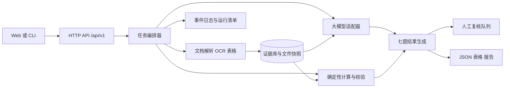

# 项目总纲 v1.0

## 1. 作品定义

构建一个在固定资料包内运行的金融投研智能体，输入是公告、财报、行业资料及研报草稿，输出是七类结构化任务结果。评审可以从结论返回原文页码和区域，并重放关键计算与任务日志。项目采用一个 Web 页面作为展示入口，后端和命令行调用同一套任务服务，便于决赛现场复现。

**七题代码（此处冻结）：**

| 代码 | 选题 | 优先级 | 主责 |
|---|---|---|---|
| `structured_extraction` | 数据结构化提取 | A：重点 | 成员 A 工程，C 标注 |
| `financial_analysis` | 上市公司财务报告分析 | A：重点 | 成员 B 财务，A 集成 |
| `industry_impact` | 产业链影响分析 | B：贯通 | 成员 B |
| `valuation` | 自动化估值建模 | B：贯通 | 成员 B，A 计算 |
| `research_verification` | 研究报告纠错核查 | A：重点 | 成员 C 评测，B 财务 |
| `investment_memo` | 买方投资备忘录编制 | B：贯通 | 成员 B |
| `report_quality` | 研究报告质量评估 | B：贯通 | 成员 C |

三人姓名暂用 A/B/C；确定队员后替换姓名。A 负责系统架构、文档解析、API、日志和部署；B 负责财务口径、计算、估值、产业链与投资逻辑；C 负责数据集、人工标注、纠错、质量评估、前端与视频。每条重点工作流至少由另一成员独立复核。

## 2. 系统边界与数据流



**模块边界：** `ingest` 登记文件和来源；`parse` 解析文本、扫描与表格；`evidence` 管理证据；`facts` 统一字段和财务口径；`tools` 提供确定性计算；`tasks` 实现七项任务；`orchestrator` 管理状态和失败恢复；`api` 提供 HTTP；`web` 展示；`eval` 负责评测。下游任务只读取 `facts` 与 `evidence`，避免重复解析原文件。

**拟采用技术：** Python 后端、SQLite 起步、文件系统固定快照、JSON Schema 校验、一个国产大模型作为核心推理引擎。当前计划书拟用 Qwen3-8B；实际模型权重、推理框架及硬件配置以验证后的版本清单为准。前端框架不预设，优先保证证据页与输出同屏。任何外部数据须先归档进固定资料包；评审运行从本地资料包读取。

## 3. 建议目录

```text
project/
  api/                  路由、请求校验、错误响应
  app/ingest/           文件登记、哈希、来源元数据
  app/parse/            PDF 文本、OCR、表格、版面坐标
  app/evidence/         证据存储与查询
  app/facts/            事实归一化、口径和版本
  app/tools/            比率、期间、估值、引用校验
  app/models/           模型适配器、提示词版本
  app/orchestrator/     任务状态机和工具调度
  app/tasks/            七个独立任务模块
  app/export/           JSON、CSV、HTML/PDF
  web/                  上传、任务、证据、复核、结果页面
  eval/                 标注、指标、失败案例
  data/raw/             原始资料，仅内部或获准分享
  data/gold/            人工标注
  runs/                 运行清单、事件、结果
  contracts/            OpenAPI、JSON Schema、样例
  docs/                 总纲、接口、成员说明
  tests/                跨模块契约与关键财务计算测试
```

推荐先实现一个小范围纵向样例：同一家公司的一份年报、一份半年报、两份公告、一份有意设置错误的研报草稿。接口稳定后扩展到多公司留出集。

## 4. 关键里程碑

| 时间 | 必须达到的状态 |
|---|---|
| 9月28日—10月1日 | 样例资料、人工标注规范、公共契约冻结；完成报名资料核对 |
| 10月2日—5日 | 文件与证据底座、结构化提取可演示 |
| 10月6日—9日 | 财报分析和研报纠错可演示；同一案例贯通 |
| 10月10日—11日 | 七题均能接受固定输入并返回符合 Schema 的结果；确认学校报名 |
| 10月12日—15日 | 三项重点题留出集评测、失败修复、计划书定稿 |
| 10月16日—17日 | 录制真实运行视频，冻结演示版本和样例包 |
| 10月18日前 | 提交初赛 PDF 与 MP4，保留平台提交成功记录 |
| 入围决赛后 | 完成最终报告、完整源码、依赖和现场实时样例 |

## 5. 完成标准

**单题完成：** 输入样例、成功输出、失败或待复核输出、Schema 校验、可定位证据、运行记录、人工核验说明均齐全。第 1、2、5 题另需留出集实测数据，分别报告精确率、召回率、误报、关键数值准确率和失败案例；不以目标值冒充结果。

**系统完成：** 七题通过同一 API 启动；数据包、模型、Prompt 和代码版本可查；关键计算可重算；固定输入能复现；Web 界面与源码版本一致。决赛按竞赛通知提交最终报告书、原型、完整源码、运行说明和现场可实时处理样例。
